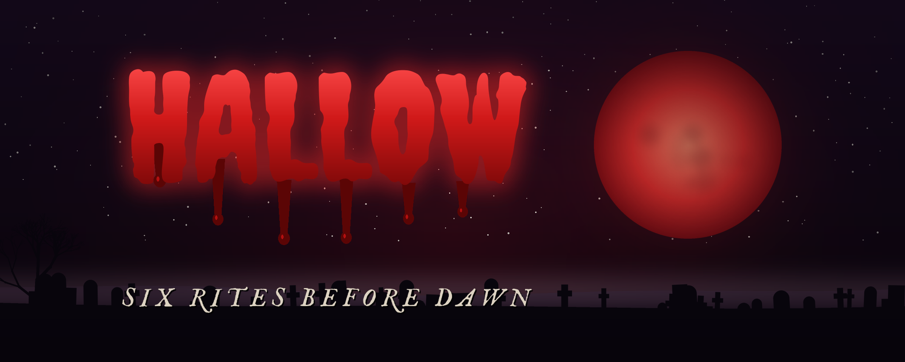

<p align="center">
  
</p>

# Hallow: Six Rites Before Dawn

A Halloween horror game for iOS, Android, Windows and the web, built with NativeScript-Vue
and [`@nativescript/canvas`](https://github.com/NativeScript/canvas). Each of the six
rites is a mini-game drawn with a different renderer; light all six candles and the
curse lifts.

Started from the
[NativeScript Canvas Starter](https://github.com/triniwiz/nativescript-canvas-starter-template).

## The rites

| Rite | Drawn with | Play |
| --- | --- | --- |
| I. The Graveyard | Canvas 2D | Hold back the dead with a dying torch: its beam burns ghosts, its battery runs out. |
| II. The Pumpkin Patch | PixiJS | Swipe to carve the lanterns before they fall. Never cut the skulls. |
| III. The Corridor | three.js | Walk the endless hall and flash-photograph what walks toward you. |
| IV. The Sigil | WebGL (GLSL) | Trace each summoning sigil before the candles gutter. |
| V. The Lost Souls | WebGPU (WGSL compute) | Lead thousands of GPU-simulated souls into the moon-gate, past the shades. |
| VI. The Séance | Canvas 2D + a Worker | The spirit spells a word on the board; say it back. |

## Around them

- **Title:** a WebGL shader scene (blood moon, haunted house, fog, lightning, eyes in the
  dark), a bleeding title drawn on a transparent 2D canvas, SVG bats and a witch.
- **Map:** will-o'-wisps, fog and a figure among the graves, drawn by a Worker into an
  OffscreenCanvas.
- **Sound:** music and recorded effects play through one Web Audio graph
  (`@nativescript/audio-context`) alongside sounds synthesized live: wind, drones, a
  heartbeat, wails, stingers, a convolution reverb.
- **Native touches:** Taptic Engine / vibrator haptics, keep-awake while playing, and an
  opt-in camera-torch strobe when lightning strikes, called straight from TypeScript.
- **Saves:** candles, best scores and settings in `ApplicationSettings`.
- **UI:** MasonKit layouts with Tailwind, CSS keyframes, SMIL-animated SVG, and the
  Creepster and IM FELL English fonts.

## Running

```bash
npm install
npm run ios       # or: npm run android / npm run windows
npm run web       # browser dev server
npm run build:web # production files in dist/web (relative paths, so it can be hosted from any sub-path)
```

The web build is published to GitHub Pages by `.github/workflows/pages.yml` on every push to `main`.

Use npm: `package.json` relies on npm `overrides`. For Windows prerequisites, see
`npx ns doctor windows`.

On the iOS Simulator, WebGL runs on a software rasterizer, so the GL scenes render at
reduced resolution there (see `src/core/gpu.ts`). The Lost Souls rite needs a WebGPU
adapter, which the Android emulator doesn't provide.

The browser build uses the regular Vue and Web APIs, with the existing rite screens and
game logic. Run it in a modern browser; if WebGPU or OffscreenCanvas Workers are missing,
the Lost Souls and Worker-drawn scenery use Canvas/main-thread fallbacks. Browser haptics
and screen wake lock are device-dependent, and the camera torch is native-only.

## Project layout

| Path | What it's for |
| --- | --- |
| `src/app.ts` | Entry: polyfills, MasonKit, `<Canvas>`/`<Svg>`, fonts. |
| `src/screens/` | Title, map (`RiteMap.vue`) and settings (`Grimoire.vue`). |
| `src/game/` | `GameShell.vue` hosts a rite: HUD, intro, pause, scares, results. `types.ts` is the contract a rite implements. |
| `src/rites/<rite>/` | One folder per rite. |
| `src/core/` | Audio engine, native APIs, saves, fonts, GPU helpers. |
| `src/web/` | Browser renderer adapters, navigation and web-only styles. |
| `src/art/` | Title shader, bleeding title, map Worker scene, SVG art. |
| `src/canvas/` | Runs a scene on a canvas or in a Worker. |
| `src/assets/` | Music loops and sound effects (MP3). |
| `tools/generate-art.py` | Regenerates the app icon, splash screens and `docs/` banner into `App_Resources/` (`pip install pillow`). |

## Credits

- Fonts: Creepster (Sideshow) and IM FELL English (Igino Marini), SIL Open Font License.
- Sound effects: the 400 Sounds Pack; Weather Elements and the MECHA Sounds Asset Pack
  (CC BY 4.0); the laugh and screams by oliper18, jusatti890 and SimpleSound (Pixabay).
- Music: Lullaby, Add-Ons, Clouds, Surveillance, Electricity and Where My Home Is.

The full-length source recordings live in `audio/`, which is not committed.

## Temporary workarounds

These come from the starter and can go once the fixes are released:

- `@nativescript/core` and `@nativescript/vite` come from pkg.pr.new builds, and
  `overrides` pins the `@nativescript/canvas*` packages to one prerelease.
- `canvas-workarounds.mjs`, `masonkit-hmr.mjs` and `postcss-selector-commas.mjs` patch
  the build (see the comments in each).
- `src/core/fonts.ts` registers the bundled fonts with the canvas directly: a `FontFace`
  that is loaded and then added doesn't reach canvas text otherwise.
- `patches/` (applied by `patch-package` on install):
  - `@nativescript/vite`: the HMR deps bundle also registers dynamic `import()` targets,
    which PixiJS needs (NativeScript/NativeScript#11584).
  - `@nativescript/core`: on Windows, `knownFolders.currentApp()` is the package's `app\`
    folder, as on iOS and Android; without it every `~/` font and sound fails to load.
  - `@nativescript/canvas`: on Windows, a mouse or touchpad hovering over a canvas no
    longer reports touch moves, and WebGL2's sized `texImage2D`/`texSubImage2D` take a
    canvas or image (PixiJS uploads text that way).
- `src/core/intl.ts` replaces `Intl.Segmenter` on Windows with `@formatjs/intl-segmenter`:
  the runtime's own crashes the app as soon as it segments a string, which PixiJS does
  for every piece of text.
